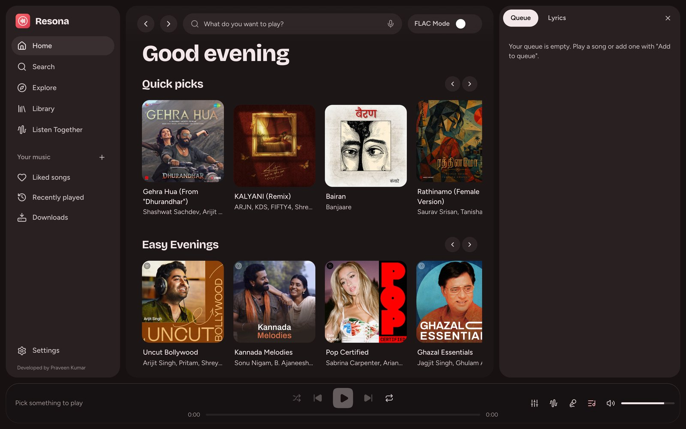
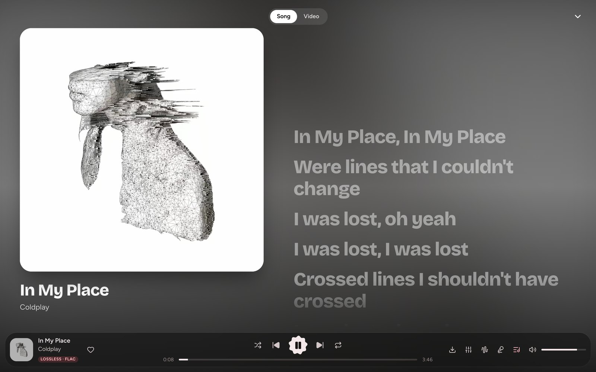
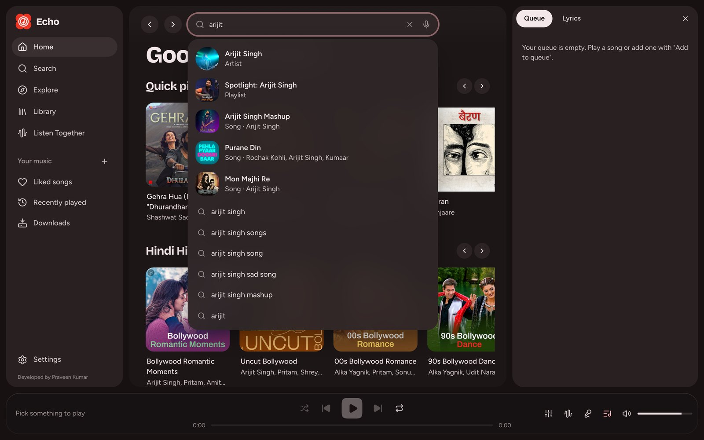
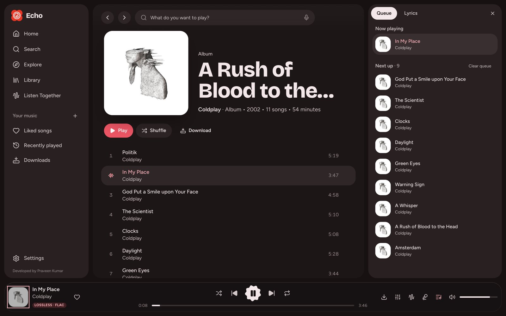
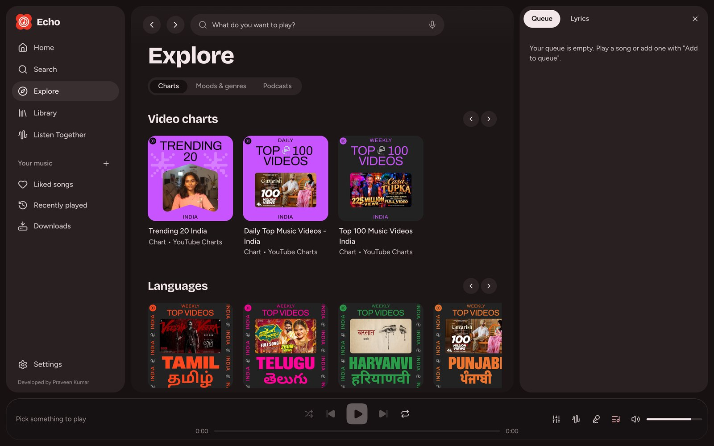
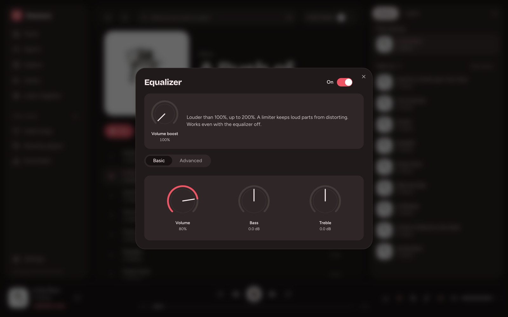

# Resona

A music app for Mac, Windows and the browser: stream without ads, with synced lyrics, lossless FLAC, offline downloads and casting to your TV.



| | |
|---|---|
|  |  |
| **Now playing** with synced lyrics and lossless FLAC | **Search** with songs, artists and playlists as you type |
|  |  |
| **Albums and the play queue** | **Explore**: charts, moods and podcasts |
|  | |
| **Equalizer** with volume boost, bass and treble | |

## Download

| | |
|---|---|
| **macOS** (Apple Silicon) | [Download for Mac](https://github.com/alwaysspraveen/resona/releases/latest/download/Resona-mac.dmg) |
| **Windows** (64-bit) | [Download for Windows](https://github.com/alwaysspraveen/resona/releases/latest/download/Resona-windows.exe) |

These always get the newest version. Installed apps update themselves (Settings → Check for updates). All versions: [Releases](https://github.com/alwaysspraveen/resona/releases).

**First launch**

- **Mac:** the app isn't notarized by Apple. If macOS says it "can't be opened" or "is damaged", move it to Applications and run this once in Terminal:
  ```sh
  xattr -dr com.apple.quarantine "/Applications/Resona.app"
  ```
- **Windows:** if you see "Windows protected your PC", click **More info → Run anyway**.

## Features

- **Lossless FLAC**: songs upgrade to FLAC automatically when available. **FLAC Mode** (top bar or Settings) plays only FLAC and searches only FLAC songs.
- **Synced lyrics** in the side panel and the full-screen Now Playing view.
- **Cast** to Chromecast, Google TV, Android TV and Nest speakers (desktop app). The laptop becomes the remote.
- **Listen Together**: share a room code and everyone hears the same song at the same moment.
- **Offline downloads** and **MP3 320 kbps** files.
- **Equalizer** (10 bands, presets, bass, treble, volume boost) and **spatial audio**.
- **Explore**: charts, moods & genres and podcasts. **Video mode**, **Canvas** motion artwork, **crossfade**.
- **Resona Brain** (beta): learns from what you play and skip, and keeps the queue going with picks for you.
- **Voice search**, a **color theme** that follows the artwork, and in-app updates.

## Run it

Needs **Node.js 22 or newer** (`node -v` to check; get it from https://nodejs.org). Works on macOS, Windows and Linux.

```sh
npm install
npm run dev
```

Run both commands from the **repository folder** (the one with this README), not from `apps/web`. Otherwise only the web page starts and every request fails with a 502.

Open the URL Vite prints (normally http://localhost:5173). `npm run dev` starts both:

- **web** (`apps/web`): the React app, on Vite's dev server
- **server** (`apps/server`): the API on http://127.0.0.1:8787. It talks to YouTube Music and LRCLIB and passes audio through to the browser.

Only localhost can reach the server. Set `HOST=0.0.0.0` (and `PORT`) only if you deliberately want other devices to reach it.

### Single-process mode

```sh
npm run build          # builds apps/web/dist
npm start -w apps/server
```

The server then also serves the built app on http://127.0.0.1:8787.

## Desktop app (Electron)

`apps/desktop` wraps the same web app and API in Electron. Pages and the API are served on a private `app://echo` scheme inside the app, so nothing listens on a network port and the library persists between launches. ffmpeg is bundled, so MP3 downloads work out of the box, and they save straight to `~/Downloads`.

```sh
cd apps/desktop
npm run dist:mac    # → release/Resona-<version>-arm64.dmg (Apple Silicon)
npm run dist:win    # → release/Resona-Setup-<version>.exe (64-bit Windows)
```

Or build the Windows installer in one step, from macOS, Linux or Git Bash on Windows (no Wine needed):

```sh
./scripts/build-windows.sh
```

The Windows installer is unsigned, so on first run Windows shows *"Windows protected your PC"*: click **More info → Run anyway**.

Builds are ad-hoc signed, not notarized. A copy built on this Mac opens normally. A copy downloaded on another Mac needs right-click → **Open** the first time.

## Settings

Open **Settings** at the bottom of the sidebar.

- **Theme:** *Match artwork* (the default) takes its colors from the cover of the song that's playing, . You can also pick one of 8 fixed colors.
- **Streaming quality:** High (Opus ~160 kbps), Normal (AAC ~128 kbps) or Data saver (Opus ~70 kbps). Changing it mid-song keeps your position.
- **Download format:** **MP3 320 kbps** by default (44.1 kHz, ID3v2.3 tags, encoded from the best source, Opus ~160 kbps). You can also pick the untouched originals: `.opus` (~160 kbps) or `.m4a` (AAC ~128 kbps). Every download is tagged with title, artist, album and cover art and saved to your browser's Downloads folder. MP3 needs `ffmpeg` on the PATH (`brew install ffmpeg`); the originals still download without it, just untagged.

**Offline downloads:** hover the download button in the player bar or Now Playing, or open a song's **Download** submenu, and choose **Save for offline**. Resona stores the song (best quality, ~160 kbps Opus) with its artwork and lyrics in the browser/app storage, and it plays with no internet. Downloaded songs show a ✓, and they're listed under **Downloads** in the sidebar. Albums and playlists have a **Download** button that saves every song. The other option, **Download MP3 file**, saves a file to your computer.

Download a song from its right-click menu, the download button in the player bar, or the Now Playing view.

## Keyboard shortcuts

| Key | Action |
|---|---|
| Space | Play / pause |
| ← / → | Seek 5 seconds |
| Shift + ← / → | Previous / next song |
| M | Mute |
| L | Like the current song |
| / | Search |
| Esc | Close the now-playing view |

Media keys and macOS Control Center work too, through the Media Session API.

## Checks

```sh
npm test            # queue + lyrics unit tests (Vitest)
npm run typecheck   # server + web
npm run smoke       # hits every API route against live YouTube Music (server must be running)
```

## How it works

- `packages/shared`: types shared by the server and the web app, plus the LRC lyrics parser.
- `apps/server`: Hono + [youtubei.js](https://github.com/LuanRT/YouTube.js). It converts YouTube Music responses into small, stable JSON shapes. Audio streams use the `VISIONOS` client, which serves the whole file without a PO token. `/api/stream/:id` turns the browser's open-ended `Range` requests into bounded ones, because googlevideo rejects `bytes=0-`.
- `apps/web`: Vite, React, Tailwind, shadcn/ui (restyled), TanStack Query, Zustand and Dexie. Liked songs, history and playlists are stored in IndexedDB, in your browser only.

Design notes: `docs/superpowers/specs/2026-11-17-resona-design.md`.

## Known limits

- No YouTube account sign-in.
- If YouTube changes its streaming rules, `VISIONOS` may stop serving full files. The server falls back to other clients, which may give only a ~1 MB preview. Updating `youtubei.js` is the usual fix.
